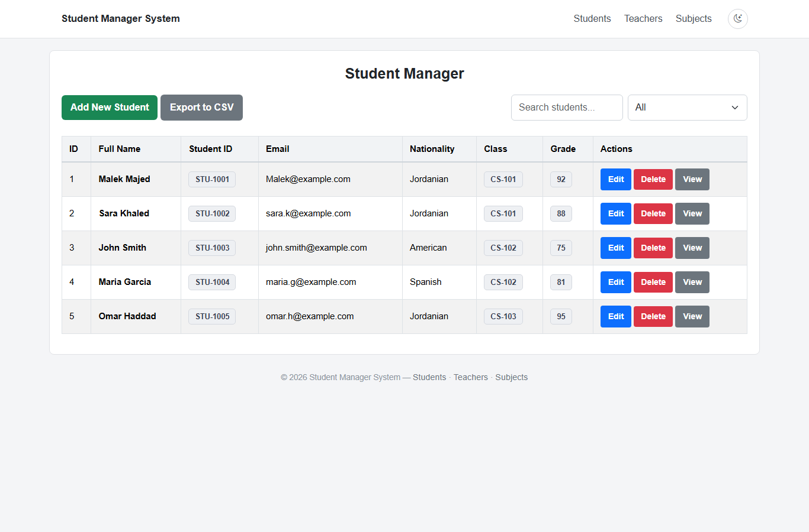
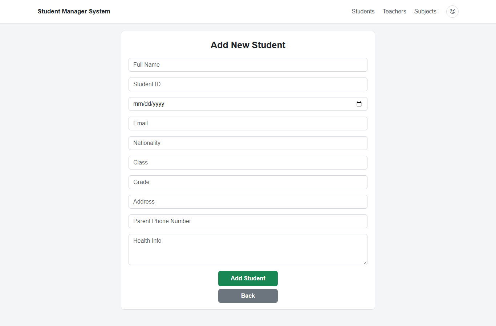
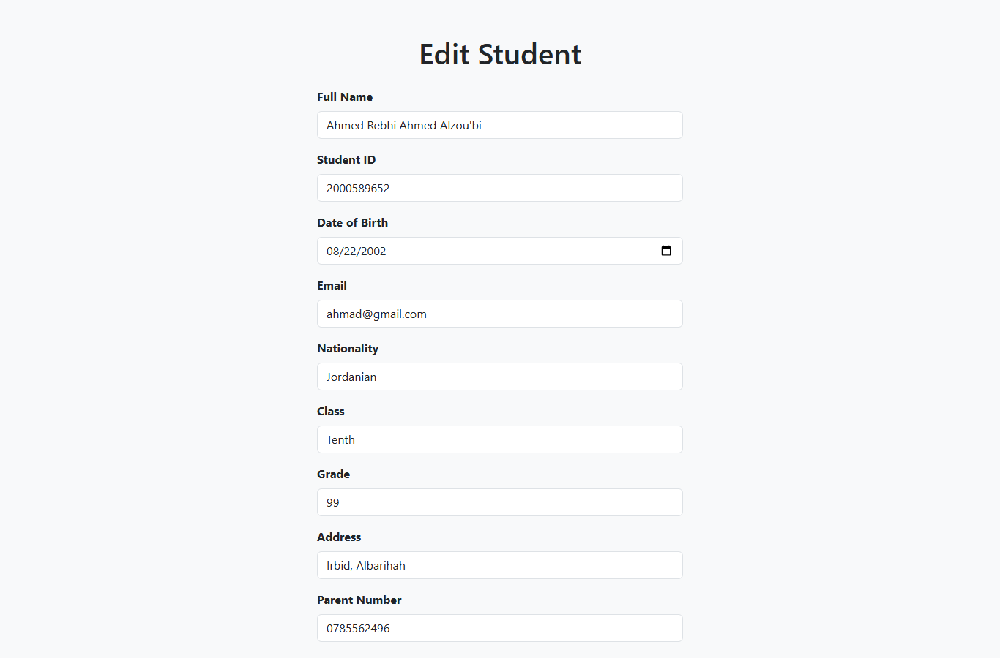

# Students Manager System

A simple PHP + MySQL web app for managing students records with full CRUD, live search, and CSV export, built for XAMPP.

## Screenshots

### Home



### Add Student



### Edit Student



## Features

- List all records in responsive table views for **Students, Teachers and Subjects**
- Teachers can be linked to a subject (foreign key + dropdown)
- Add new records with server-side validation and friendly duplicate detection
- View details page for each record
- Edit existing records
- Delete with confirmation (AJAX, no page reload)
- Live search and filter with AJAX (no page reload)
- Export students list to CSV
- Form validation for required fields, email, and grade
- PDO prepared statements for secure database access
- Modern light-blue theme with **dark mode toggle** (preference saved in localStorage)
- Clean MVC-like separation (models, views, controllers)
- Responsive UI with custom CSS
- Any DB outage renders a clear message instead of a raw fatal error

## Technologies

- HTML
- CSS
- JavaScript
- PHP 8
- PDO
- MySQL
- Bootstrap 5
- jQuery

## Project Structure

```
app/
  controllers/
    StudentController.php
    TeacherController.php
    SubjectController.php
  models/
    Database.php
    Student.php
    Teacher.php
    Subject.php
  views/
    partials/
      navbar.php          (shared top navigation + dark mode toggle)
    students/
      index.php create.php edit.php show.php
    teachers/
      index.php create.php edit.php show.php
    subjects/
      index.php create.php edit.php show.php
public/
  index.php               (Students)
  teachers.php
  subjects.php
  actions/
    search_student.php delete_student.php export_students.php
    search_teacher.php delete_teacher.php
    search_subject.php delete_subject.php
  assets/
    css/style.css         (theme: light blue + dark mode variables)
    js/script.js          (AJAX delete/search, any module via window.AppConfig)
    js/site.js            (dark mode toggle, localStorage persistence)
database.sql              (creates student_manager + students + sample data)
database_upgrade.sql      (adds subjects + teachers + sample data)
docs/
  screenshots/
README.md
```

## Installation

Clone the repository:

```bash
git clone https://github.com/Ahmed-Alzoubi-az9/Student-Management-System.git
```

Run the project using a local Apache environment such as XAMPP.

1. Copy the project to `C:\xampp\htdocs\Students_Manager_System`
2. Start Apache + MySQL in XAMPP
3. Import `database.sql` then `database_upgrade.sql` with phpMyAdmin (creates `student_manager` + sample data)
4. Open the app: `http://localhost/Students_Manager_System/public/index.php`

Pages:
- Students: `public/index.php`
- Teachers: `public/teachers.php`
- Subjects: `public/subjects.php`

DB login is in `app/models/Database.php` (default: `root` / no password).

## Notes

Note: This is a university training project. It was recreated for learning purposes and customized during training to practice PHP CRUD operations, PDO database handling, MVC-like structure, Bootstrap responsive layouts, AJAX live search, and basic frontend/backend integration.
